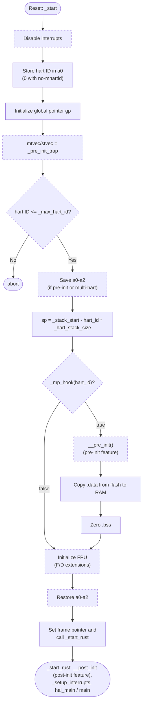

# `riscv-rt`

> Minimal runtime / startup for RISC-V CPU's.

This project is developed and maintained by the [RISC-V team][team].

## [Documentation](https://docs.rs/crate/riscv-rt)

## Startup sequence

The following chart is a simplified view of how `_start` (defined in [`src/asm.rs`](src/asm.rs))
initializes the target before handing control to Rust code. Dashed nodes depend on Cargo features
or on the target ISA extensions.

In single-hart builds, the hart ID check and `_mp_hook` are skipped and the stack pointer
is set to `_stack_start`. The default `_mp_hook` returns `true` for hart 0 and parks all
other harts in a `wfi` loop.

## Minimum Supported Rust Version (MSRV)

This crate is guaranteed to compile on stable Rust 1.61 and up. It *might*
compile with older versions but that may change in any new patch release.

## License

Copyright 2018-2022 [RISC-V team][team]

Permission to use, copy, modify, and/or distribute this software for any purpose
with or without fee is hereby granted, provided that the above copyright notice
and this permission notice appear in all copies.

THE SOFTWARE IS PROVIDED "AS IS" AND THE AUTHOR DISCLAIMS ALL WARRANTIES WITH
REGARD TO THIS SOFTWARE INCLUDING ALL IMPLIED WARRANTIES OF MERCHANTABILITY AND
FITNESS. IN NO EVENT SHALL THE AUTHOR BE LIABLE FOR ANY SPECIAL, DIRECT,
INDIRECT, OR CONSEQUENTIAL DAMAGES OR ANY DAMAGES WHATSOEVER RESULTING FROM LOSS
OF USE, DATA OR PROFITS, WHETHER IN AN ACTION OF CONTRACT, NEGLIGENCE OR OTHER
TORTIOUS ACTION, ARISING OUT OF OR IN CONNECTION WITH THE USE OR PERFORMANCE OF
THIS SOFTWARE.

## Code of Conduct

Contribution to this crate is organized under the terms of the [Rust Code of
Conduct][CoC], the maintainer of this crate, the [RISC-V team][team], promises
to intervene to uphold that code of conduct.

[CoC]: ../CODE_OF_CONDUCT.md
[team]: https://github.com/rust-embedded/wg#the-risc-v-team
